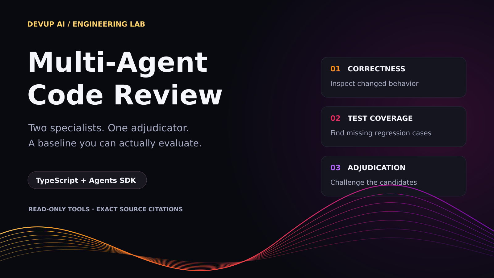
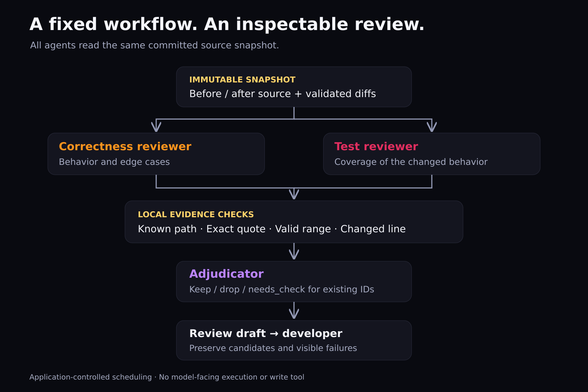
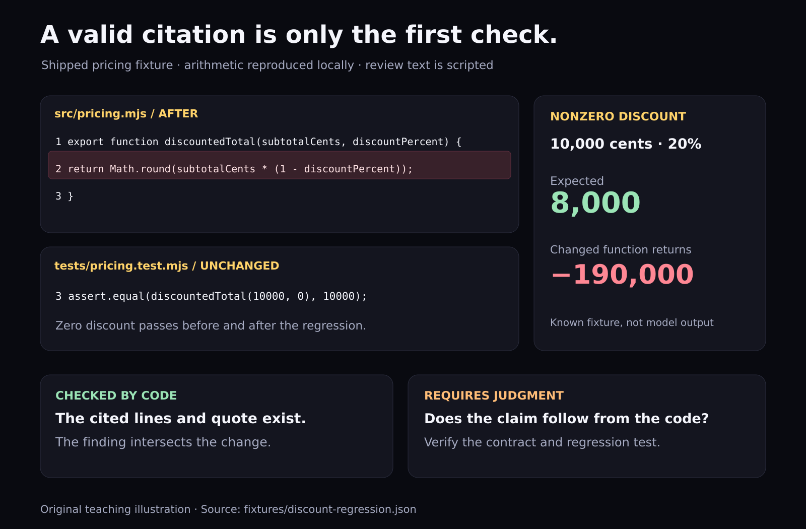
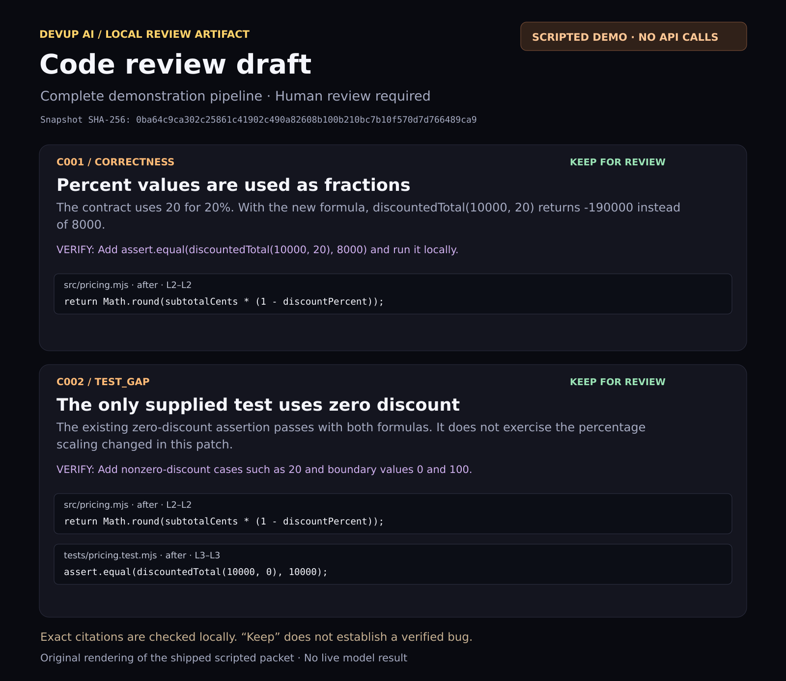

A code review can look thorough while missing the one input that breaks the feature.

Consider a pricing function whose contract represents a 20% discount as `20`:

```diff
 export function discountedTotal(subtotalCents, discountPercent) {
-  return Math.round(subtotalCents * (100 - discountPercent) / 100);
+  return Math.round(subtotalCents * (1 - discountPercent));
 }
```

The existing assertion still passes:

```js
assert.equal(discountedTotal(10000, 0), 10000);
```

But a nonzero discount exposes the regression. For `10000` cents and `20`, the new function returns **`-190000`**, instead of **`8000`**. The companion project's local tests reproduce those values.

This is a useful task for a review pipeline: one reviewer examines behavior, another examines test coverage, and a third challenges their findings before a human reads the report.

In this tutorial, we build that pipeline with **DEVUP AI, TypeScript, and the OpenAI Agents SDK**. We also keep a single-reviewer mode, because adding agents is an architectural choice that should be evaluated.

> **Disclosure and validation:** I build DEVUP AI. This guide uses its public interfaces. The source, deterministic demo, SDK protocol fixtures, and local checks were tested on Node.js **24.19.0**. The included candidate findings are hand-authored fixtures. No live DEVUP AI review or model-quality benchmark was performed for this article.

## 1. Define the output before creating the agents

Our deliverable is a **review draft**, with inspectable source references and an explicit run status.

| Stage | Responsibility | Output |
| --- | --- | --- |
| Capture | Read explicitly selected files at two Git commits | Before/after snapshot and unified diffs |
| Correctness reviewer | Look for behavioral problems introduced by the change | Candidate findings |
| Test reviewer | Look for missing coverage of the changed behavior | Candidate test gaps |
| Local validation | Check paths, ranges, exact quotes, and changed-line anchors | Accepted or rejected stage output |
| Adjudicator | Keep, drop, or question existing candidates | One decision per candidate ID |
| Developer | Verify the reasoning and proposed regression test | Final review decision |

The review tools can list supplied files, read diffs, and read source lines. They cannot edit a repository, run project code, or post comments.



*Figure 1. The application controls scheduling. This is a diagram of the included implementation, not a screenshot of DEVUP AI or DEVUP Code.*

This uses **code-controlled orchestration**: start two independent runs, wait for both, validate their outputs, then start the adjudicator. The SDK's [orchestration guide](https://openai.github.io/openai-agents-js/guides/multi-agent/) describes parallel and chained agent runs. We do not need a manager model to choose this fixed sequence.

## 2. Run the offline example first

The companion package includes the source, pinned dependencies, fixtures, tests, and original figures. Extract it and open a terminal in `devup-multi-agent-reviewer`:

```bash
npm ci
npm test
npm run typecheck
npm run demo
```

Use Node.js 24. The project uses `.mts` files and erasable TypeScript syntax, so its scripts run directly with Node. Type checking remains a separate command.

The demo writes `out/demo/review.json` and `out/demo/review.md`. It makes **zero API requests**. Its terminal output explicitly labels it:

```text
SCRIPTED DEMO — no API requests, no model-quality measurement.
Snapshot: discount-regression.json
Candidates: 2 · retained for human review: 2
Draft saved to out/demo/review.md and review.json.
```

Both modes receive the same review snapshot. In the team mode, separate run histories prevent one specialist from simply copying the other's answer. They can still make correlated mistakes, especially when using the same model.

The project is divided into small modules:

```text
src/core.mts       Snapshot, tools, evidence checks, report renderer
src/capture.mts    Explicit-path capture from two Git commits
src/agents.mts     SDK agents and DEVUP AI client
src/pipeline.mts   Single/team scheduling and failure handling
src/cli.mts        Opt-in live review
src/demo.mts       Deterministic offline example
src/score.mts      Scoring for manually labelled live runs
```

## 3. Give every reviewer the same source

A line number becomes ambiguous if a file changes while the review runs. We avoid that by capturing committed blobs at two resolved commit SHAs. The working tree is outside this capture.

Each selected file contributes:

```ts
{
  path: "src/pricing.mjs",
  before: "...source at base commit...",
  after: "...source at head commit...",
  diff: "...ordinary unified diff..."
}
```

The capture script requires explicit paths. Include the changed source, relevant tests, and a small contract document when intended behavior needs explanation. A reviewer cannot retrieve an unlisted dependency later.

For your own repository:

```bash
npm run capture -- /path/to/repository HEAD~1 HEAD snapshot.json src/pricing.mjs tests/pricing.test.mjs CONTRACT.md
```

The file must not already exist. Inspect its contents before starting a live review: these are the source excerpts that may be sent to the model. Explicit selection and filename restrictions are not a secret scanner.

The loader validates the snapshot and verifies each diff against both versions. It checks the hunk text and reconstructs the post-change lines. A missing or inconsistent diff fails locally before a model run starts.

The captured object is then cloned and frozen. A SHA-256 hash identifies the validated snapshot in the report. That hash identifies the supplied review input; it does not certify that the selected context is sufficient.

### Keep the teaching example bounded

| Resource | Lab limit |
| --- | --- |
| Serialized snapshot | 160,000 bytes |
| Explicit files | 8 |
| Source text per side | 16,000 JavaScript string code units |
| Diff per file | 20,000 code units |
| One source read | 80 lines |
| Tool calls per agent | 12 |
| Model turns per agent | 6 |
| Requested output cap per model call | 3,000 tokens |
| Cancellation deadline for the pipeline | 90 seconds |

These are application choices, not DEVUP AI platform limits or a guaranteed spending cap. The collector is intentionally limited to small UTF-8 text changes in SHA-1 Git repositories. Binary files, symlink blobs, combined diffs, and mode-only or newline-only changes are outside this lab's useful scope.

## 4. Connect the SDK to DEVUP AI

DEVUP AI's [TypeScript Agents SDK guide](https://docs.devupai.com/docs/integrations/openai-agents-sdk-typescript) documents the integration. This project explicitly creates a Responses model for each agent:

```ts
import OpenAI from 'openai';
import {
  Agent, OpenAIResponsesModel, setTracingDisabled,
} from '@openai/agents';

setTracingDisabled(true);

const client = new OpenAI({
  apiKey: process.env.DEVUP_API_KEY,
  baseURL: 'https://api.devupai.com/v1',
  maxRetries: 0,
  timeout: 45_000,
});

// Inside each agent's configuration:
const model = new OpenAIResponsesModel(
  client,
  process.env.DEVUP_REVIEW_MODEL!,
);
```

The executable version validates both environment variables. Trace export is disabled because traces can contain reviewed source. The client and agent model settings disable automatic retries in this lab.

Choose the exact model ID from the current [catalog](https://docs.devupai.com/docs/models). The live path needs tool calling and structured output through the selected endpoint. Catalog support and the integration documentation guide the choice; a small live smoke test is still necessary for the model and pinned SDK combination you deploy.

The [Responses documentation](https://docs.devupai.com/docs/responses) describes the public endpoint and client-supplied conversation history. The included SDK protocol test checks that the tool result is returned in the next request without a `previous_response_id`.

## 5. Expose a small, read-only tool surface

Each agent receives three application-owned functions:

- `list_files`: names and line counts from the snapshot.
- `get_diff`: the diff for one exact supplied path.
- `read_lines`: a bounded range from the `before` or `after` version.

For example, the SDK wrapper for a line read is:

```ts
tool({
  name: 'read_lines',
  description: 'Read an inclusive range from a before/after snapshot.',
  parameters: z.object({
    path: z.string(),
    side: z.enum(['before', 'after']),
    startLine: z.number().int(),
    endLine: z.number().int(),
  }).strict(),
  execute: async args => JSON.stringify(access.readLines(args)),
});
```

`access.readLines` checks the path against the snapshot, checks the inclusive range, enforces the per-read limit, and increments the agent's tool budget. Its output pairs each line number with the original line text.

There is no filesystem path resolution inside this model-facing tool. A request for `../../something` cannot turn into an arbitrary file read: the tool only looks up an exact key in the supplied snapshot.

The instructions also tell agents to treat code, comments, and tool results as data. That instruction is not a guarantee against prompt injection. The concrete capability boundary comes from the tools the application actually exposes.

## 6. Validate evidence outside the model

A candidate contains a category, title, explanation, proposed verification step, and one or more citations:

```ts
const EvidenceSchema = z.object({
  path: z.string(),
  side: z.enum(['before', 'after']),
  startLine: z.number().int().min(1),
  endLine: z.number().int().min(1),
  quote: z.string().min(1).max(2500),
}).strict();
```

The SDK accepts a Zod schema as an agent's `outputType`, as documented in its [agent guide](https://openai.github.io/openai-agents-js/guides/agents/). The project then applies source-specific checks after schema validation:

1. The cited path exists in this snapshot.
2. The range exists on the declared side.
3. The quote equals those source lines exactly, including whitespace.
4. At least one citation in the finding intersects an added or removed line.

Deleted code can be cited on the `before` side. Test-gap findings can cite both the changed function and an unchanged test, as long as at least one citation anchors the change.



*Figure 2. Original illustration generated from the shipped fixture. The arithmetic is reproduced locally; the candidate review text is scripted.*

These checks establish **source consistency**. They cannot establish that an explanation follows from the source. The test suite includes a deliberately false explanation with a real quote; the source validator accepts it. This test preserves an important boundary rather than hiding it.

## 7. Separate scheduling from judgment

The first two agents have different scopes:

- The correctness reviewer returns `correctness` candidates.
- The test reviewer returns `test_gap` candidates.

The single-agent baseline covers both scopes. The pipeline rejects a specialist output containing the wrong category.

The scheduling core uses `Promise.allSettled`:

```ts
const roles = mode === 'single'
  ? ['single']
  : ['correctness', 'tests'];

const settled = await Promise.allSettled(
  roles.map(async role => {
    const response = await invoke({
      role, snapshot, candidates: [], signal,
    });
    return {
      ...response,
      findings: validateReview(response.output, snapshot),
    };
  }),
);
```

Each successful result receives application-assigned candidate IDs. The adjudicator receives those candidates and the same snapshot tools. It must return exactly one decision per ID:

- `keep`: retain for human review.
- `drop`: unsupported, redundant, or outside scope.
- `needs_check`: insufficient evidence to decide.

It cannot introduce a new ID or rewrite the original evidence. Unknown, duplicate, or missing decision IDs reject the adjudication stage.

**A retained candidate is not a verified bug.** A second model's agreement is another judgment, not independent ground truth.

### Fail visibly

If one specialist fails, the report is marked **incomplete**, surviving candidates remain available, and adjudication is skipped. If adjudication fails, all candidates remain available with `needs_check` decisions.

If both reviewers successfully return no candidates, the run can be complete. That says the pipeline finished, not that the code is correct.

The SDK exposes turn limits and an abort signal in its [running-agents guide](https://openai.github.io/openai-agents-js/guides/running-agents/). We pass one shared cancellation signal to all stages and cap each agent's turns. This controls work; it does not undo already processed or billed requests.



*Figure 3. Rendered preview of the actual offline demo packet. This is a local report, not a live model result or a product screenshot.*

## 8. Opt into a live run

Use `.env.example` as a template. Keep the real key in your local `.env`:

```dotenv
DEVUP_API_KEY=REPLACE_WITH_PRIVATE_API_KEY
DEVUP_REVIEW_MODEL=REPLACE_WITH_TOOL_AND_SCHEMA_CAPABLE_MODEL_ID
```

Start with the small public fixture:

```bash
node --env-file=.env src/cli.mts fixtures/discount-regression.json single out/discount-single-01
node --env-file=.env src/cli.mts fixtures/discount-regression.json team out/discount-team-01
```

These commands make paid API requests using your DEVUP AI balance. Each output directory must be new. The CLI saves a JSON packet and a Markdown draft, and returns exit code `2` for an incomplete run.

For a source snapshot you have inspected, replace the fixture path with `snapshot.json`.

## 9. Evaluate the extra agents

The package contains three human-authored cases:

| Fixture | Intended evaluation target |
| --- | --- |
| `discount-regression` | Percentage-scaling regression and the missing nonzero-discount test |
| `clean-refactor` | Equivalent calculation; avoid inventing introduced problems |
| `removed-validation` | Deleted quantity guard and missing invalid-quantity coverage |

These tiny cases are teaching fixtures, not a representative code-review benchmark.

Use the same model, snapshot, per-agent limits, and rubric in both modes. Repeat runs, and alternate which mode runs first to reduce ordering effects. Record model IDs, package versions, date, snapshot hash, and failures.

This comparison measures **the pipeline configuration**. The team has additional model calls and a larger total resource allowance. It does not isolate the effect of specialization from extra computation. A later experiment could give the single reviewer a comparable total budget or add a single-agent revision pass.

### Label the results yourself

For each complete live run, inspect every retained or `needs_check` candidate. Label it as a true positive, false positive, or duplicate against the declared expected-issue IDs. Preserve a written reason. If a valid unexpected issue appears, revise the rubric and re-label both modes consistently.

The scoring command checks the snapshot hash and requires labels for every retained candidate:

```bash
npm run score -- out/discount-team-01/review.json labels.json out/discount-team-01/score.json
```

`evaluation.md` includes the exact label format and review procedure. The scorer refuses scripted demos and incomplete runs. It counts duplicates against precision, counts each expected issue once, and reports undefined precision or recall as `null` when their denominator is zero.

Compare:

- **Precision:** distinct expected issues found / all retained candidates.
- **Recall:** expected issues found / expected issues in this fixture's rubric.
- **Duplicates and invented locations:** inspect whether more output adds useful information.
- **Completion rate:** report failed runs separately instead of quietly dropping them.
- **Wall time and reported input/output tokens:** inspect the stage metrics.

Token usage is not settled cost. This lab does not collect settled DZD billing: `costDzd` remains `null`. Failed requests can still consume resources, so a run with missing stage usage is marked with `usageComplete: false`.

There is deliberately no fabricated single-versus-team results chart in this article.

## 10. What the local checks establish

The supplied suite passes **55 local tests**, plus TypeScript checking. It covers snapshot/diff consistency, exact evidence, deleted-line citations, tool bounds, immutable inputs, adjudication IDs, report escaping, failure propagation, and manual scoring rules.

Two tests exercise the real pinned SDK with an in-memory HTTP response fixture. They check tool-call serialization and replay, structured output handling, usage accounting, and rejection of an incomplete terminal response. The fixture fetch returns locally; it never contacts a live API.

The known pricing fixture is also executed locally to verify the opening example. The review agents themselves have no execution tool.

What remains to establish is live endpoint compatibility for the selected configuration and review quality on representative changes. Those require actual model runs and human assessment. The architecture keeps that evaluation visible: a fixed input, explicit evidence, preserved failures, and a baseline you can compare.

### References

- [DEVUP AI: TypeScript Agents SDK integration](https://docs.devupai.com/docs/integrations/openai-agents-sdk-typescript)
- [DEVUP AI: Responses API](https://docs.devupai.com/docs/responses)
- [DEVUP AI: model capabilities](https://docs.devupai.com/docs/models)
- [OpenAI Agents SDK: agents and output types](https://openai.github.io/openai-agents-js/guides/agents/)
- [OpenAI Agents SDK: orchestration](https://openai.github.io/openai-agents-js/guides/multi-agent/)
- [OpenAI Agents SDK: running agents](https://openai.github.io/openai-agents-js/guides/running-agents/)

*Source and original figures are included in the companion project. DEVUP Code's Agent mode is separate from this tutorial.*
